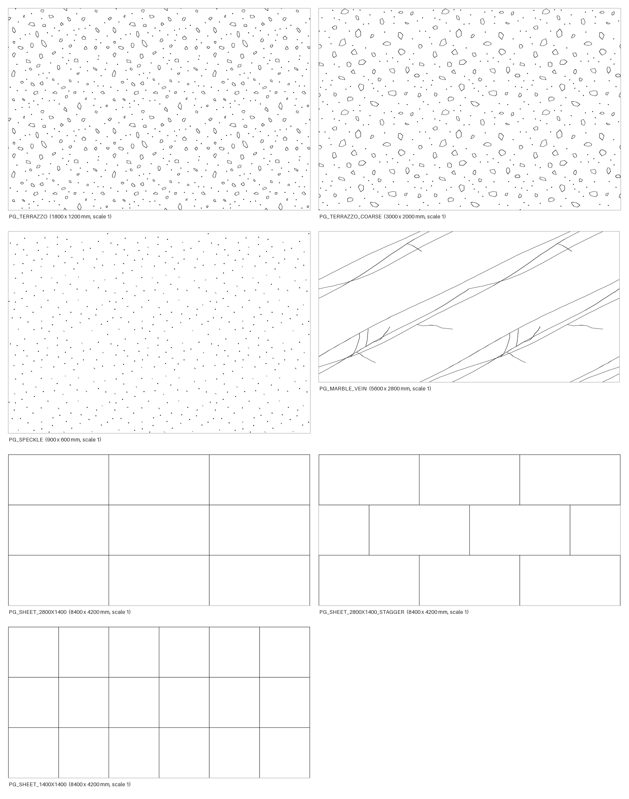

# Polygood для AutoCAD — черновик v1.0

Штриховки и блоки листов Polygood для AutoCAD, плюс те же штриховки для Revit. Это черновик к Шагу 5 плана: перед выпуском его нужно проверить в настоящем AutoCAD (чек-лист внизу).



## Что внутри

| Папка / файл | Что это |
|---|---|
| `hatches/autocad/*.pat` | 7 штриховок для AutoCAD, по одной в файле (AutoCAD требует, чтобы имя файла совпадало с именем штриховки) |
| `hatches/revit/Polygood_Revit_model.pat` | Те же 7 штриховок одним файлом, как модельные образцы Revit |
| `blocks/Polygood_AutoCAD_blocks.dxf` | 15 блоков листов и демо-чертёж с примерами штриховок |
| `previews/` | Картинки всех штриховок и демо-чертежа |
| `tools/build_autocad.py` | Скрипт, который всё это собирает |

### Штриховки

| Имя | Что рисует | Повтор |
|---|---|---|
| `PG_SHEET_2800X1400` | Швы листов 2800 × 1400 мм | — |
| `PG_SHEET_2800X1400_STAGGER` | Швы листов 2800 × 1400 мм вразбежку | — |
| `PG_SHEET_1400X1400` | Швы листов 1400 × 1400 мм | — |
| `PG_TERRAZZO` | Терраццо: 52 крошки 13–48 мм и 70 точек на повтор | 600 мм |
| `PG_TERRAZZO_COARSE` | Терраццо: 34 крупные крошки 36–89 мм и 60 точек на повтор | 1000 мм |
| `PG_SPECKLE` | Мелкая крапинка | 300 мм |
| `PG_MARBLE_VEIN` | Прожилки под мрамор | 2800 мм |

Штриховки узоров стилизованные: они обозначают тип рисунка на чертеже, а не копируют конкретный узор Polygood. Какую штриховку ставить к какому из 10 узоров, решаете вы. Если нужны отдельные штриховки под конкретные узоры, пришлите их фото.

### Блоки

Точка вставки — левый нижний угол. Геометрия лежит на слое 0, поэтому блок принимает слой, на который его вставили.

| Блок | Что это |
|---|---|
| `PG_SHEET_2800x1400_FACE`, `PG_SHEET_1400x1400_FACE`, `PG_SHEET_1000x1000_FACE` | Лист в плане или на фасаде, контур |
| `PG_SECTION_<толщина>x<длина>` | Лист в разрезе, серая заливка (цвет 8). Толщины 12 и 19 мм, длины 2800, 1400 и 1000 мм |
| `PG_EDGE_<толщина>x<длина>` | Кромка листа на виде, контур. Те же толщины и длины |

## Как поставить штриховки в AutoCAD

1. Скопируйте папку `hatches/autocad` в постоянное место, например `C:\Polygood\Hatches`.
2. Наберите `OPTIONS` → вкладка **Files** → **Support File Search Path** → **Add** → **Browse**, выберите папку → **OK**.
3. Наберите `HATCH`. Штриховки `PG_…` появятся в конце списка образцов на ленте. В классическом окне выберите тип **Custom**.
4. Масштаб 1 означает миллиметры. Если чертёж в дюймах, ставьте масштаб 0.03937.
5. Чтобы швы начинались от угла стены, на ленте **Hatch Creation** откройте **Origin** и выберите **Bottom Left**. Без этого швы отсчитываются от начала координат чертежа.
6. Поворот штриховки листов на 90° даёт вертикальные листы 1400 × 2800.

## Как пользоваться блоками

1. Откройте `blocks/Polygood_AutoCAD_blocks.dxf` в AutoCAD.
2. Проверьте пару размеров командой `DIST`: например, длину `PG_SHEET_2800x1400_FACE`.
3. Сохраните как DWG: `SAVEAS` → тип **AutoCAD 2013/LT2013 Drawing (*.dwg)**. Такой файл открывается во всех версиях с 2013 года.
4. Вставка в свой чертёж: `INSERT` → вкладка **Libraries** → выберите этот DWG. Можно и через `ADCENTER` (Ctrl+2): откройте файл, раздел **Blocks**, перетащите блок.

## Как поставить штриховки в Revit

**Manage** → **Additional Settings** → **Fill Patterns** → **Model** → **New** → **Custom** → **Import** → файл `hatches/revit/Polygood_Revit_model.pat` → выберите штриховку из списка. В материале её удобно ставить как фоновый узор поверхности (Surface Pattern → Background), а швы листов — как передний план (Foreground).

## Чек-лист проверки в AutoCAD

- [ ] Прямоугольник 5600 × 2800 со штриховкой `PG_SHEET_2800X1400` и началом в левом нижнем углу делится ровно на 4 листа.
- [ ] `PG_SHEET_2800X1400_STAGGER` на том же прямоугольнике: верхний ряд сдвинут на 1400 мм.
- [ ] `PG_TERRAZZO` на квадрате 3000 × 3000: нет видимых швов, обрывов и пустых полос.
- [ ] Штриховки работают при масштабе 0.5 и 2 и при повороте на 45°.
- [ ] Блоки вставляются через `INSERT` → **Libraries** с правильными размерами.
- [ ] Файл, сохранённый как DWG 2013, открывается у коллеги в другой версии AutoCAD.
- [ ] В Revit файл `.pat` импортируется без ошибок. Если Revit ругается, пришлите текст ошибки.

## Что сверить до выпуска

- **Размеры и толщины** взяты из открытых источников ([Wikipedia](https://en.wikipedia.org/wiki/Polygood), [сертификат Cradle to Cradle](https://c2ccertified.org/certified-products/plastic-sheets-made-of-recycled-polymers-of-styrene-in-primary-forms-tm-polygood)): листы 2800 × 1400, 1400 × 1400, 1000 × 1000 мм, толщины 12 и 19 мм. Сверьте их с техпаспортом. Если что-то отличается, поменяйте `SHEETS` и `THICKNESSES` в начале скрипта и пересоберите.
- **Проверено без AutoCAD.** Геометрию штриховок я проверил двумя независимыми рендерами: своим по правилам формата .pat и рендером библиотеки ezdxf по DXF. DXF проходит проверку ezdxf без ошибок, каждая строка .pat не длиннее 80 символов. В настоящих AutoCAD и Revit файлы ещё не открывались — для этого чек-лист выше.

## Пересборка

Нужен Python 3 с пакетами ezdxf, Pillow и matplotlib:

```bash
pip install ezdxf pillow matplotlib
python tools/build_autocad.py
```

Скрипт перезаписывает `hatches/`, `blocks/` и `previews/` и собирает архив в `dist/`. Случайные числа фиксированы, поэтому без изменений в скрипте файлы получаются те же.
