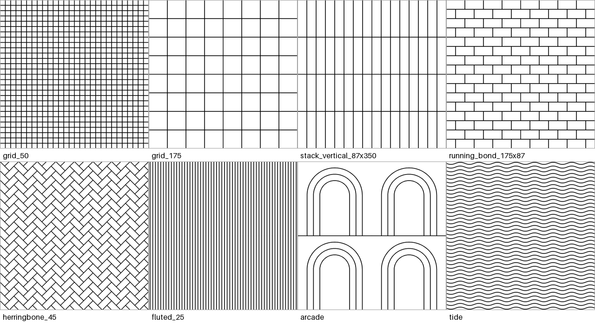

# RELIEF: hotel concept with Polygood® engraved wall tiles

A design brief and a ready-to-run Claude Code setup for building a boutique hotel in Blender
with Bonsai (IFC). It combines the 2026 hotel interior trends from Dezeen with Polygood Wall
Tiles and their CNC engraving.



## What is in this folder

| File | What it is |
|---|---|
| `CLAUDE.md` | The master instructions. Claude Code loads it, with `BRIEF.md`, when you start it here |
| `BRIEF.md` | The design brief: concept, spaces and sizes, Polygood rules, engraving concepts, materials, furniture, lighting, cameras |
| `STAGES.md` | The prompts to paste, one stage at a time |
| `REFERENCES.md` | Dezeen projects and Polygood Notion pages behind each decision |
| `textures/grooves/` | Eight groove layouts as SVG drawings and tileable PNG height maps (one 700 × 700 mm module each) |
| `tools/groove_patterns.py` | Regenerates or adds groove layouts |

## Run it from your terminal

1. **Get the files** on the computer where Blender runs:
   ```bash
   git clone https://github.com/pertsevaolexa-sys/claude-remote-control.git
   cd claude-remote-control
   git checkout claude/sharp-lovelace-43th0c
   cd polygood-hotel-concept
   ```
   If you already have the repository: `git fetch origin && git checkout claude/sharp-lovelace-43th0c && git pull`.

2. **Open Blender** with the Bonsai add-on, and start the Bonsai MCP server inside Blender the
   way your setup does it. Save an empty file in this folder, for example `relief_v000.blend`.

3. **Check that Claude Code sees Bonsai MCP:**
   ```bash
   claude mcp list
   ```
   The Bonsai server should show as connected.

4. **Start Claude Code in this folder:**
   ```bash
   claude
   ```
   `CLAUDE.md` and `BRIEF.md` load automatically.

5. **Paste Stage 0** from `STAGES.md`, read the report, then go on stage by stage. Each stage
   stops and waits for your approval.

## Change or add engravings

```bash
pip install pillow
python3 tools/groove_patterns.py --list
python3 tools/groove_patterns.py                    # redraw all, 1/4" cutter
python3 tools/groove_patterns.py --cutter 4         # 5/32" cutter, narrower grooves
```

To add a pattern, write a small function in `tools/groove_patterns.py` that returns groove
centrelines in millimetres and add it to `LAYOUTS`. Spacing must divide 700 mm so the pattern
runs on across panels. The SVG is also the drawing to send to Polygood for a custom engraving.

## Before you show renders outside the team

- Polygood colours marked `APPROX` or `TEXTURE_NEEDED` are not product matches. Replace them
  with photos of real samples first.
- Groove depth, joint width and wet-zone approval for each colour are assumptions. See
  `BRIEF.md` section 11.
- The hotel is invented. Don't present the renders as a real project.
